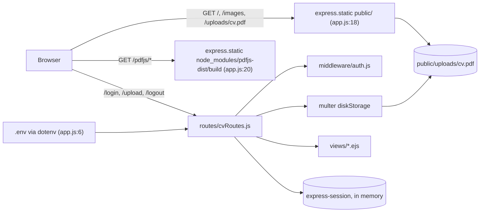

# portfolio-site - documentation hub

A Node.js and Express server that publishes one hard-coded portfolio page
(`public/index.html`) with the owner's CV, renders the CV's PDF in the page
with PDF.js, and lets one administrator log in and replace that PDF
(`routes/cvRoutes.js`). The repository also carries the lab tooling the owner
uses across his repositories: `recipe.ps1`, Claude Code hooks under `.claude/`
and five Gitea workflows under `.gitea/workflows/`. Who visits the site and
where it is hosted is not stated in the repository (see
[Open questions](../SPEC.md#9-open-questions)).

## Status

- Last commit on this branch (`ps-57/docs/spec-md`): `8ec8c69`, 2026-11-17
  21:19:22 +0200, "docs(spec): add SPEC.md mirrored as Jira KAN-57"
  (`git log -1`), on top of `test` at `14d2a49`. 21 commits in total. Apart
  from `SPEC.md`, the tree is the same as `release` at `8ba71c6`
  (`git diff --stat release HEAD`). The server code dates from 2025-04-25
  (the page last changed on 2026-08-07), the lab tooling from 2026-11-07.
- Tests: none for the JavaScript. `recipe.ps1 test` runs pytest and ruff over
  `.claude/` only (`recipe.ps1:41-55`); pytest collects 0 tests there (run on
  2026-11-20, exit code 5, which the recipe accepts at `recipe.ps1:47-48`).
  Jira KAN-57 holds the task "Automated tests for the routes"
  ([SPEC.md, section 3.8](../SPEC.md#38-declared-but-not-implemented)).
- CI: five Gitea Actions workflows in `.gitea/workflows/` (`propose`,
  `release-gate`, `release`, `sweep`, `test`), all `runs-on: windows`. There is
  no `.github/` directory, so GitHub runs nothing for this repository. Whether
  a Gitea runner serves it is not known: the README says the old Node.js CI/CD
  was not carried over "because this server has no runner for them"
  (`README.md`, "Working on it").
- TODO/FIXME: 0 in the project's own files; 17 case-insensitive matches inside
  the vendored PDF.js build in `public/js/pdfjs/` (not project code).
- Evidently unfinished or left over:
  - `public/js/main.js` is referenced by no page and fetches `/api/cv`
    (`public/js/main.js:9`), a route that does not exist in
    `routes/cvRoutes.js`.
  - `views/upload_form.html` and `views/upload_success.html` are older,
    unrendered versions of the EJS views; `public/css/style.css` is linked only
    from them. The Jira task "Remove the unused front-end leftovers" proposes
    deleting these files, `main.js` and the vendored PDF.js.
  - The README lists five exceptions to lab revision 4.0.0: R-02 (#7),
    R-09 (#8), R-37 (#9), R-41 (#10), R-42 (#11) (`README.md`, "Lab
    requirements").
  - `package.json:17` says `ISC`; `LICENSE` is MIT (the README notes this).

## Layout

| Path | What it is |
|---|---|
| `app.js` | Server entry point: static files, PDF.js mounts, session, EJS, routes, 404/500 handlers. |
| `routes/cvRoutes.js` | Routes `/`, `/login`, `/upload`, `/logout`; multer upload configuration. |
| `middleware/auth.js` | Redirects a request without an authenticated session to `/login`. |
| `views/*.ejs` | Login form, upload form, upload result (rendered). |
| `views/*.html` | Older Russian-language versions of the upload pages (not rendered). |
| `public/index.html` | The portfolio page and its inline PDF viewer script. |
| `public/images/photo.jpg` | Portrait; stored in Git LFS (`.gitattributes:10`). |
| `public/js/pdfjs/build/` | Vendored PDF.js 4.10.38 (`pdf.mjs:21521`), 2,868,101 bytes in two files; referenced only by the unreferenced `main.js`, as its worker path (`main.js:7`). |
| `public/js/main.js` | Alternative viewer script, not loaded by any page. |
| `public/css/style.css` | Stylesheet used only by `views/*.html`. |
| `package.json`, `package-lock.json` | npm metadata, scripts and locked dependencies. |
| `recipe.ps1` | The repository's command interface (`test`, `info`, `clean`, and no-op verbs). |
| `SPEC.md` | Requirements specification; its task list mirrors Jira KAN-57. |
| `docs/README.md` | This hub. |
| `CLAUDE.md` | Working rules for the repository (branches, commits, gates). |
| `.claude/` | Claude Code settings, hooks, git hooks, ruff/pytest config, `lab-ai-env` skill. |
| `.gitea/` | Workflows and the issue / pull request templates. |

## Architecture

One Node.js process. Express serves `public/` as static files
(`app.js:18`), serves PDF.js from `node_modules/pdfjs-dist/build` under
`/pdfjs` (`app.js:20`), parses form bodies (`app.js:24`), keeps a session with
`express-session` (`app.js:28-36`) and mounts `routes/cvRoutes.js`
(`app.js:48`). The upload route writes the file through multer to
`public/uploads/cv.pdf` (`routes/cvRoutes.js:12-23`); the same file is then
served statically at `/uploads/cv.pdf`, which the page's script loads with
PDF.js (`public/index.html:409-410`). No database. No session store is passed
to `express-session`, so it uses its default in-memory store; on a run of
2026-11-20 a restart ended a logged-in session.

The browser also loads Tailwind from `cdn.tailwindcss.com`
(`public/index.html:8`, every `views/*.ejs`), the Inter font from Google Fonts
(`public/index.html:9-11`), and, if the portrait fails to load, a placeholder
image from `placehold.co` (`public/index.html:88`).

## Build and run

Prerequisites:

- Node.js and npm. `package.json` has no `engines` field; the locked
  `pdfjs-dist` 4.10.38 declares `node >=20` (`package-lock.json:1318-1320`).
  The lockfile is `lockfileVersion: 3` (`package-lock.json:4`). `npm ci
  --omit=dev` from it reported `added 123 packages` on Node v23.11.0 on
  2026-11-20; 114 of them were on disk, the other nine being optional
  `@napi-rs/canvas` builds for other platforms.
- Git LFS to get the real `public/images/photo.jpg`: the committed blob is an
  LFS pointer (`.gitattributes:10`).
- For `recipe.ps1`: PowerShell, and Python with pytest and ruff 0.16.1
  (`.claude/ruff.toml:2` refuses any other ruff version).

Commands:

| Command | What it does | Source |
|---|---|---|
| `npm install` | Install the dependencies | `README.md` |
| `npm start` | `node app.js` | `package.json:7`, `README.md` |
| `npm run dev` | `nodemon app.js` (restarts on change) | `package.json:8` |
| `.\recipe.ps1 test` | pytest, `ruff check`, `ruff format` over `.claude/`; also sets `core.hooksPath` | `recipe.ps1:41-55` |
| `.\recipe.ps1 info` | Print name, code, version, summary | `recipe.ps1:56-62` |
| `.\recipe.ps1 clean` | Delete `__pycache__`, `.pytest_cache`, `.ruff_cache` | `recipe.ps1:63-68` |
| `.\recipe.ps1 build` (also `install`, `uninstall`, `run`, `publish`) | Prints `nothing to <verb>` | `recipe.ps1:69-73` |

The server prints `Server listening at http://localhost:<port>` on start
(`app.js:54`).

## Configuration

The server reads a `.env` file through `dotenv` (`app.js:6`); `.env` is
gitignored (`.gitignore:28`).

| Variable | Meaning | Default | Source |
|---|---|---|---|
| `PORT` | Listening port | `3001` | `app.js:13` |
| `ADMIN_USERNAME` | The one administrator's login name | none; login answers "Server configuration error." | `routes/cvRoutes.js:62-69` |
| `ADMIN_PASSWORD` | That administrator's password, compared as plain text | none; as above | `routes/cvRoutes.js:63-73` |
| `SESSION_SECRET` | Session cookie signing secret | 32 random bytes as hex, new at each start | `app.js:27` |
| `NODE_ENV` | `production` makes the session cookie `secure` and silences the weak-secret warning | unset | `app.js:33`, `app.js:55` |

`recipe.ps1` separately loads `.claude/.env` into variables that are not
already set (`recipe.ps1:30-38`); that file is gitignored (`.gitignore:24`) and
holds the lab's keys, not the server's settings. The server has no CLI flags.

## Usage

- Visitor: open `/`. The page shows About, Experience, Skills, Education, CV
  and Contact sections (`public/index.html:71-76`). The CV section renders
  `/uploads/cv.pdf` one page at a time with Previous / Next buttons and offers
  a download link (`public/index.html:232-245`).
- Owner, replacing the CV:
  1. Open `/login`, enter `ADMIN_USERNAME` and `ADMIN_PASSWORD`
     (`views/login.ejs:25-35`). Success redirects to `/upload`
     (`routes/cvRoutes.js:79`).
  2. Choose a PDF of at most 5 MB in the `cvFile` field and submit
     (`views/upload_form.ejs:28-31`). The file replaces
     `public/uploads/cv.pdf`; the result page links back to `/` and to
     `/upload` (`views/upload_success.ejs:21-28`). A file over the limit is
     refused and also removes the current CV (see below).
  3. Log out with the "Log Out" button, a `POST /logout`
     (`views/upload_form.ejs:45`).
- A fresh checkout has no `public/uploads/` (`.gitignore:29`), so until the
  first upload `/uploads/cv.pdf` answers 404 (seen on 2026-11-20) and the page
  shows "Failed to load PDF: ..." and hides the viewer
  (`public/index.html:415-424`; not checked in a browser).

## Testing

There are no automated tests of the server or the page. `recipe.ps1 test` is
the only test command and covers `.claude/`, which holds no Python file and
so no test yet (`git ls-files '*.py'` lists none; `.claude/pytest.ini`). The
workflows `propose`, `release-gate` and `test` call `.\recipe.ps1 test` and
then `git diff --exit-code` (`.gitea/workflows/propose.yaml:144-152`).
`release-gate` reads a manual test list from `tests/manual/tests.json`
(`.gitea/workflows/release-gate.yaml:107-137`); the file does not exist, and an
empty list counts as passed (`release-gate.yaml:139-140`). Manual checks that
match the requirements are listed in [SPEC.md, section 8](../SPEC.md#8-acceptance).

On 2026-11-20 the server code of this branch was copied to a temporary
directory, installed with `npm ci --omit=dev`, started with `node app.js` and
driven with curl: login, logout, the upload refusals, a valid upload, the 404
handler and a restart. The results are the "Run 2026-11-20" notes in
[SPEC.md, section 3](../SPEC.md#3-functional-requirements). No browser was
used.

## Known limitations and problems

Each item is read from the code; the ones marked "run" were reproduced on
2026-11-20 against a temporary copy of this branch's server code.

- `public/js/main.js` requests `/api/cv` (`main.js:9`), which has no route, and
  imports the bare specifier `pdfjs-dist` (`main.js:2`); no page loads it.
- The vendored `public/js/pdfjs/build/` is referenced only by that `main.js`
  (worker path, `main.js:7`); the
  page loads PDF.js from `node_modules` through `/pdfjs` (`index.html:287-294`,
  `app.js:20`), so the page needs `npm install` to have run.
- `views/upload_form.html` names its file field `cvfile` (line 19), while the
  route expects `cvFile` (`routes/cvRoutes.js:98`); the file is not rendered,
  so this matters only if someone revives it. Run: a file sent as `cvfile` was
  refused with `Upload error: Unexpected field`.
- Login compares the password in plain text with `ADMIN_PASSWORD`
  (`routes/cvRoutes.js:73`); the code comment at line 72 suggests hashing. No
  rate limit and no CSRF token: no such package is in `package.json`. Jira
  KAN-57 holds the task "Hash the admin password and limit login attempts".
- The upload filter checks only the MIME type the client declares
  (`routes/cvRoutes.js:27`), not the file content.
- The upload is written straight to the final name `cv.pdf`
  (`routes/cvRoutes.js:21`). Run: after a valid upload, a 6 MiB upload was
  refused with `Upload error: File too large` and left `public/uploads/`
  empty, so `/uploads/cv.pdf` answered 404. Jira KAN-57 holds the task "Keep
  the current CV when an upload is refused".
- The message on the login and upload forms is not removed after it is shown:
  the handlers delete it after `res.render` (`routes/cvRoutes.js:56`, `93`),
  and the deletion is not saved. Run: `Invalid username or password.` stayed
  on three successive `GET /login` and on `/upload` after the next successful
  login; moving the deletion before `res.render` in the copy made it appear
  once.
- Sessions use the in-memory default (no `store` in `app.js:28-36`). Run:
  after a restart with the same `SESSION_SECRET`, a logged-in cookie was
  redirected from `/upload` to `/login`.
- With `NODE_ENV=production` the cookie is `secure` (`app.js:33`) and there is
  no `trust proxy` setting; behind a TLS-terminating proxy the cookie may not be
  set (inference from Express behaviour, not tested).
- Failed logins log the submitted username to the console
  (`routes/cvRoutes.js:82`). Run: the line appeared in the server output.
- The page's text is hard-coded in `public/index.html`; only the PDF can be
  replaced through the site.
- Without Git LFS the portrait is a 130-byte pointer file and the page falls
  back to the `placehold.co` image (`public/index.html:88`).
- The README's link to lab requirements revision 4.0.0 points to
  `http://127.0.0.1:3000/...`, which resolves only on the machine that runs that
  Gitea server.

## Related documents

- [README.md](../README.md) - project overview and lab compliance line.
- [SPEC.md](../SPEC.md) - requirements specification reverse-engineered from
  the code; its section 3 is the task list mirrored as Jira KAN-57.
- [CLAUDE.md](../CLAUDE.md) - working rules (issues, branches, commits, gates).
- [LICENSE](../LICENSE) - MIT.
- [recipe.ps1](../recipe.ps1) - the repository's command interface.
- [Issue template](../.gitea/issue_template.md) and
  [pull request template](../.gitea/pull_request_template.md).
- [lab-ai-env skill](../.claude/skills/lab-ai-env/SKILL.md) - report on the
  Claude Code hook log.

## About this document

Written on 2026-11-18 from commit `8ba71c6` (branch `release`). Checked on
2026-11-20 against branch `ps-57/docs/spec-md` at `8ec8c69` (based on `test`
at `14d2a49`), whose tree differs from `release` only by `SPEC.md`; the commit
facts above are those of this branch.

Commands run to check it (read-only for the repository):

- On 2026-11-18: `git status -sb`, `git log`, `git ls-files`, `git branch -a`,
  `git check-attr filter -- public/images/photo.jpg`, `git cat-file -s`,
  `git ls-tree`, `git diff --name-status` between remote branches (with
  `GIT_NO_LAZY_FETCH=1`, no network); `grep` for TODO/FIXME and for references
  to `main.js`, `style.css`, `/api/cv`.
- On 2026-11-20, on this branch: `git status -sb`, `git log`,
  `git rev-list --count`, `git diff --stat release HEAD`, `git ls-files`,
  `git grep` for TODO/FIXME and for `main.js`, `style.css`, `/api/cv`.
- `node --check` on `app.js`, `middleware/auth.js`, `routes/cvRoutes.js`: all
  three parse (Node v23.11.0 on the writing machine; not a project requirement).
- `.\recipe.ps1 info`: printed the four metadata lines, exit 0.
  `.\recipe.ps1 build`: printed `nothing to build`, exit 0 (both on
  2026-11-20).
- `python -m pytest .claude --collect-only -q -p no:cacheprovider`:
  `no tests collected`, exit 5 (2026-11-20).
- The black-box run described under [Testing](#testing), in a temporary
  directory outside the checkout: `git archive HEAD`, `npm ci --omit=dev`,
  `node app.js`, curl.

Not run: `npm install`, `npm start` or `npm run dev` inside the checkout,
`.\recipe.ps1 test` (it writes `core.hooksPath` into the git config and
reformats files in place), `.\recipe.ps1 clean`, any workflow, any browser
check of the page.

`SPEC.md` on this branch merges the requirements specification written next
to this hub with the first `SPEC.md` of 2026-11-17 (Jira KAN-57); section 9,
question 11 of `SPEC.md` records how.
